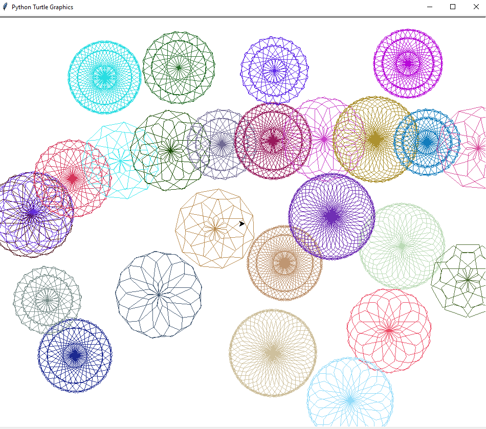

# Beautiful-Madala

This Python application uses the Turtle interface to create colorful mandalas. It allows drawing by clicking with the right mouse button and resetting the drawing by clicking with the left button.

## Features

- **Mandala drawing**: Click with the right mouse button to draw circles of different colors and form mandalas.
- **Reset**: Click with the left mouse button to reset the drawing and start over from scratch.

## Installation

1. Make sure you have Python installed on your system.
2. Download or clone this repository on your machine.
3. Run the `mandala.py` file with Python.

Usage
Run the mandala.py file.
Click with the right mouse button to draw circles of different colors.
Click with the left mouse button to reset the drawing.

